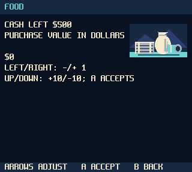
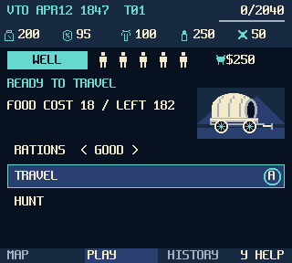
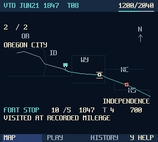

# Voyage to Oregon

A wagon-trail survival game for Analogue Pocket openFPGA, by [alfatreze](https://github.com/alfatreze). An adaptation of the 1978 classic, with original additions inspired by MECC's 1980s version.

Equip your journey, manage supplies, decide when to hunt or stop at a fort, and try to reach Oregon before winter.

- Classic rules with an explicit starting setup and supply purchases.
- A departure screen for rations, travel and hunting, followed by results showing what happened.
- Map, Play and History tabs; the map records actual fort stops and established fatal outcomes.
- Timing-based shooting with an animated target; aiming does not determine success.
- Three save slots, configurable face-button mapping and an optional 2× large view.
- Original pixel illustrations, including four fort designs that avoid consecutive repeats during a session.

| Setup | Travel | Map |
|---|---|---|
|  |  |  |

Screenshots use the game's renderer at its native 320×288 resolution. They show scripted example states.

## Play

The first community-test download is being prepared. Available builds will appear under [Releases](https://github.com/alfatreze/Voyage-to-Oregon/releases); follow [installation and controls](INSTRUCTIONS.md) for each published build. Its release notes will identify the tested build, device requirements and known issues. This repository contains player documentation and test releases.

The game is not an official MECC or Analogue release. Pocket save states and sleep/resume are not supported. Use the game's save slots and normal Pocket menu Quit.

## Feedback

Please [open an issue](https://github.com/alfatreze/Voyage-to-Oregon/issues) with the build version, Pocket firmware, steps to reproduce and what you expected. A screenshot and the relevant save help when available. Include your settings and recent actions for balance feedback. Remove personal information before uploading files; the game does not automatically upload gameplay data.

## Developer

By **alfatreze**. If you would like to support development: [Buy Alfatreze a Coffee](https://buymeacoffee.com/alfatreze).

The [community-test terms](TEST_TERMS.md) permit testing, screenshots/video and redistribution of unchanged release ZIPs, credited to alfatreze. Third-party notices accompany each download and retain their own terms. Free access to a test build does not make its game source or artwork open source.
